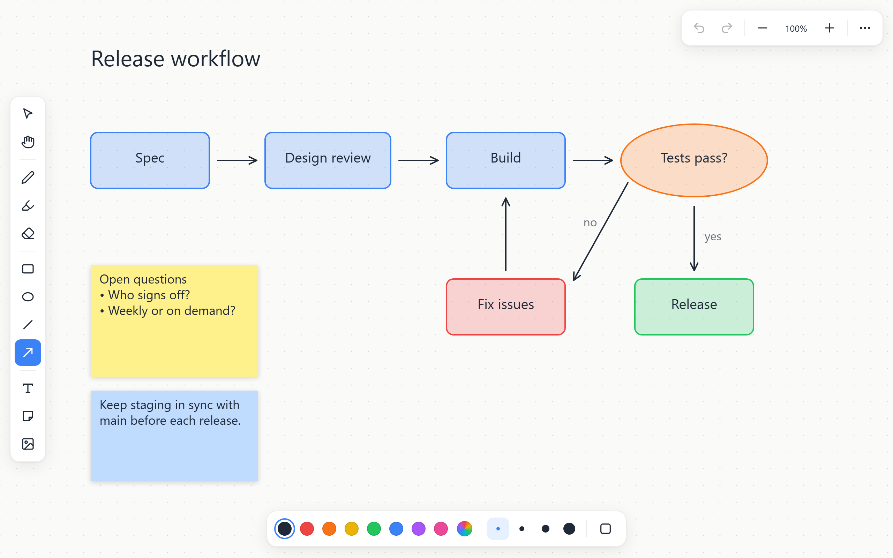
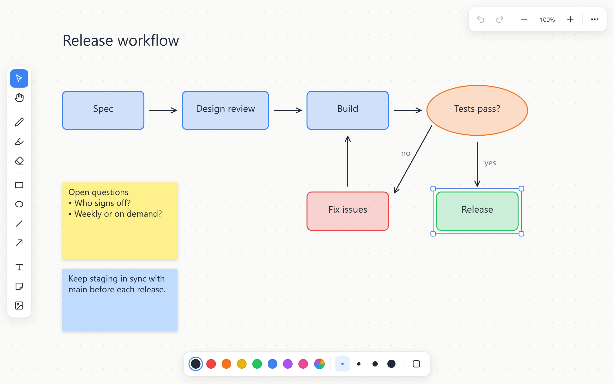
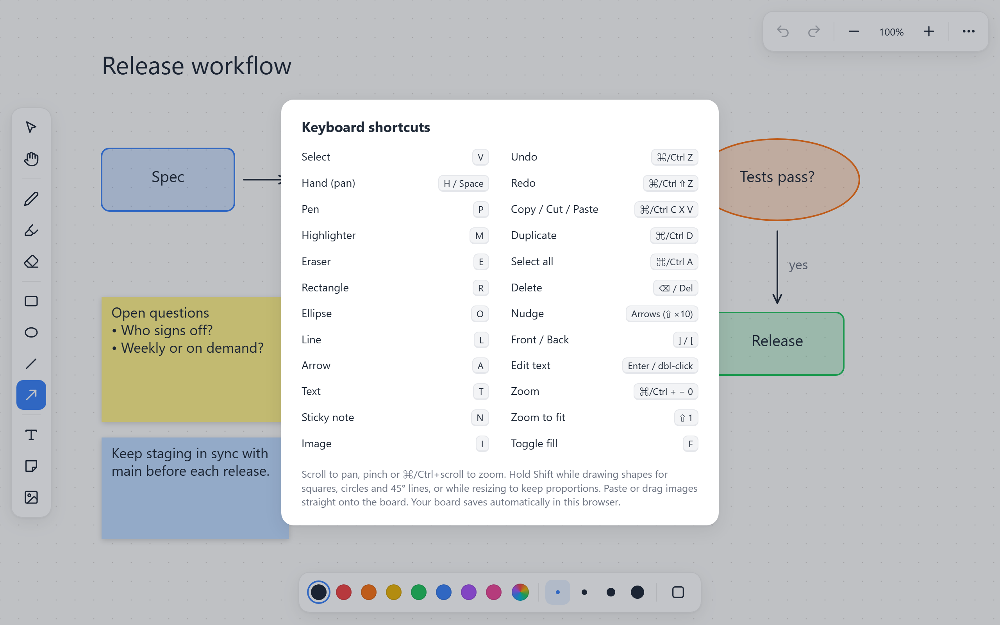

# Whiteboard

A fast, infinite-canvas whiteboard that runs entirely in your browser. It's two files, with no build step, no dependencies, no account and no server.



## Why

This project is one HTML page and one JavaScript file. Open it and start drawing. Your board saves to your browser's local storage as you go, so it's there the next time you open the page. Nothing leaves your machine unless you export it.

## Features

- **Infinite canvas**: pan with scroll, the hand tool or Space+drag. Zoom with pinch or Ctrl/⌘+scroll, from 10% to 800%.
- **Drawing**: smooth pen, translucent highlighter and an eraser that removes whole strokes.
- **Shapes**: rectangles, ellipses, lines and arrows, with optional fill. Hold Shift for squares, circles and 45° angles.
- **Text and sticky notes**: double-click anywhere to type. Sticky notes wrap their text and take on the current color.
- **Images**: paste from the clipboard, drag files onto the board, or press `I`.
- **Select, move and resize**: marquee selection, Shift-click to add items, corner handles, arrow-key nudging, and bring to front or send to back.
- **Editing**: copy, cut, paste, duplicate and 200 levels of undo/redo.
- **Save and share**: autosaves locally. You can also export a PNG, or save and open boards as `.json` files.
- **Touch friendly**: pointer events with two-finger pinch and pan on tablets and phones.



## Getting started

```sh
git clone https://github.com/kylebelanger/whiteboard.git
cd whiteboard
```

Then open `index.html` in any modern browser. You can also serve the folder with any static file server, such as `npx serve` or `python -m http.server`, or host it on GitHub Pages as is.

## Keyboard shortcuts

Press `?` in the app for the full list.



| Tool | Key | Action | Key |
|---|---|---|---|
| Select | `V` | Undo / Redo | `Ctrl/⌘ Z` / `Ctrl/⌘ ⇧ Z` |
| Hand (pan) | `H` or hold `Space` | Copy / Cut / Paste | `Ctrl/⌘ C X V` |
| Pen | `P` | Duplicate | `Ctrl/⌘ D` |
| Highlighter | `M` | Select all | `Ctrl/⌘ A` |
| Eraser | `E` | Delete | `Backspace` / `Del` |
| Rectangle | `R` | Nudge | Arrow keys (`⇧` ×10) |
| Ellipse | `O` | Front / Back | `]` / `[` |
| Line | `L` | Edit text | `Enter` / double-click |
| Arrow | `A` | Zoom in / out / reset | `Ctrl/⌘ + − 0` |
| Text | `T` | Zoom to fit | `⇧ 1` |
| Sticky note | `N` | Toggle fill | `F` |
| Image | `I` | Save board | `Ctrl/⌘ S` |

## How it works

- `index.html` holds the UI: the toolbars, menu, help dialog and styles.
- `whiteboard.js` holds everything else in about 1,100 lines of plain JavaScript. It draws to a single `<canvas>`, using a camera transform for pan and zoom.
- A board is a flat list of plain JSON elements (`path`, `rect`, `ellipse`, `line`, `arrow`, `text`, `sticky`, `image`). Undo/redo works by taking a snapshot of that list, and the saved `.json` file is the same list.
- Images are stored inline as data URLs. Very large images are scaled down so autosave fits in local storage. If a board gets too big to autosave, use **Save board** in the menu.
- For tinkering, the browser console exposes `window.whiteboard` with `state`, `camera`, `undo`, `redo`, `exportPNG`, `exportJSON`, `fitToContent` and `setTool`.
